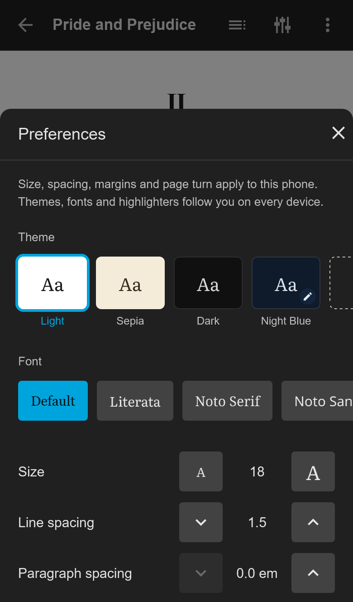

<h1 align="center">
  <br>
  <picture>
    <source media="(prefers-color-scheme: dark)" srcset="branding/oriel-lockup-dark.svg">
    
  </picture>
  <br>
  <br>
</h1>

Oriel is an e-book reader for Jellyfin, hosted by the Jellyfin server as a plugin. It opens EPUB books from your Jellyfin libraries in the browser, on a phone's home screen, and inside the official Jellyfin apps, using the account you are already signed in with.

**Oriel is an unofficial, third-party plugin.** It is not made, endorsed or supported by the Jellyfin project, and it does not use the Jellyfin logo.

<p align="center">
  
  &nbsp;
  
</p>

<p align="center">
  
</p>

## Status

Early development; there is no release yet. What works today:

- A reader page at `/Oriel/?id=<itemId>` that renders EPUB books from your library with [foliate-js](https://github.com/johnfactotum/foliate-js).
- Play and Resume on a book in jellyfin-web open Oriel instead of the built-in reader. Oriel adds this itself as jellyfin-web is served, with no other plugin to install; an admin can turn it off in Oriel's settings.
- In a desktop browser, pages turn with the arrow keys, Space, Page Up and Page Down, a click on the left or right edge, the mouse wheel or a two-finger trackpad swipe.
- Oriel keeps your exact place in each book, per user, and opens where you stopped, also after reading in another app.
- Admins set Oriel up under **Dashboard → Plugins → Oriel**: whether Play and Resume open Oriel, whether readers may add their own fonts (off until an admin turns it on), and the Translate address. Translate opens Google Translate by default; the text a reader selects is sent to that site, and an admin can change the address to another https site or clear it to turn Translate off.
- Your reading positions can be exported to a file and imported again, on the same server or another one, through `/Oriel/Export` and `/Oriel/Import`.

Oriel has been tried in Safari and the Jellyfin app on iOS, and in the Jellyfin app on Android. Reader settings and annotations are planned but not built yet.

## Requirements

- Jellyfin 12.2 or later. Each change is tested on 12.2 (`jellyfin/jellyfin:12.2.20261005-225228`) and on the latest 12.x (`jellyfin/jellyfin:12.4.20261026-211555` today).

## Installing

Once the first release is published, Oriel installs from its own plugin repository:

1. In Jellyfin, open **Dashboard → Plugins → Repositories** (on older versions, **Catalog → Settings**) and add a repository with any name and this URL:
   `https://pathimmersive.github.io/jellyfin-plugin-oriel/manifest.json`
2. Find **Oriel** in the plugin catalog and install it.
3. Restart the Jellyfin server.

Updates appear in the same catalog. Each release's zip is also attached to its [GitHub release](https://github.com/pathimmersive/jellyfin-plugin-oriel/releases) for manual installs: unzip it into a folder named `Oriel_<version>` in the server's `plugins` folder and restart.

## Your data

Oriel keeps each user's reading data (places, bookmarks, highlights and notes, highlighters, themes, fonts and the theme and font they chose) in one SQLite file, `oriel.db`, in the plugin's data folder: `plugins/Jellyfin.Plugin.Oriel` under Jellyfin's configuration folder (`/config/plugins/Jellyfin.Plugin.Oriel/oriel.db` in the official Docker image). Jellyfin's own backup does not include it; each user can export their data from Oriel's Your reading data page.

When Jellyfin deletes a user, Oriel deletes everything it keeps for them. A user deleted while Oriel was not loaded is caught the next time the server starts.

Uninstalling Oriel leaves `oriel.db` in place, so reinstalling keeps everyone's data. To remove it, stop Jellyfin and delete the `plugins/Jellyfin.Plugin.Oriel` folder.

## Building and testing

You need the .NET 10 SDK, Node.js 24 with npm, bash and, for the smoke test, Docker.

```bash
dotnet test                            # builds the reader and the plugin, runs the plugin tests
npm --prefix src/reader test           # reader unit tests
bash scripts/smoke-plugin.sh           # loads the plugin into a throwaway Jellyfin container and checks it end to end
bash scripts/check-community-files.sh  # community files and third-party notices
bash scripts/test-package.sh           # release packaging: the zip and the repository manifest (needs Python 3)
```

`scripts/dev-server.sh` runs a local Jellyfin server with the current build installed; run it with no arguments for its usage.

## Releasing

Releases are switched off until the repository variable `RELEASES_ENABLED` is set to `true` under **Settings → Secrets and variables → Actions → Variables**. While it is off, a pushed tag runs the release workflow, which fails at its first job with "Releases are switched off" and builds, releases and publishes nothing.

Once releases are on, pushing a tag `vX.Y.Z` on `main` runs the release workflow: it builds the plugin as version `X.Y.Z.0`, attaches `oriel_X.Y.Z.0.zip` and its SHA-256 (`oriel_X.Y.Z.0.zip.sha256`) to a GitHub release, and publishes `manifest.json` to GitHub Pages with every earlier version still listed. The zip's build provenance is attested, so `gh attestation verify oriel_X.Y.Z.0.zip --repo pathimmersive/jellyfin-plugin-oriel` shows it was built by this repository's release workflow. The build runs no dependency install scripts, and the job that publishes builds nothing; only repository admins can push `v*` tags. `scripts/package-plugin.py` does the packaging and can be run locally the same way.

## Contributing and security

See [CONTRIBUTING.md](CONTRIBUTING.md) and the [Code of Conduct](CODE_OF_CONDUCT.md). Report security problems privately, as [SECURITY.md](SECURITY.md) describes.

## License

Oriel is licensed under the GNU General Public License v3.0 or later; see [LICENSE](LICENSE). Third-party code keeps its own license; see [THIRD_PARTY_NOTICES.md](THIRD_PARTY_NOTICES.md).
