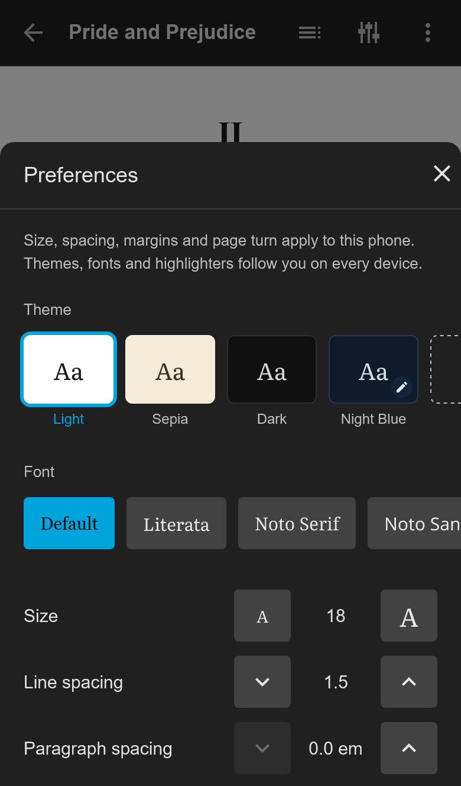

<h1 align="center">
  <br>
  <picture>
    <source media="(prefers-color-scheme: dark)" srcset="branding/oriel-lockup-dark.svg">
    
  </picture>
  <br>
  <br>
</h1>

Oriel is an e-book reader for Jellyfin, hosted by the Jellyfin server as a plugin. It opens EPUB, PDF, CBZ comic, MOBI and AZW3 books from your Jellyfin libraries in the browser, on a phone's home screen and inside the official Jellyfin apps. It uses the account you are already signed in with, and keeps your place, bookmarks, highlights and preferences on the server for every device.

**Oriel is an unofficial, third-party plugin.** It is not made, endorsed or supported by the Jellyfin project, and it does not use the Jellyfin logo.

<p align="center">
  
  &nbsp;
  
</p>

<p align="center">
  
</p>

## What Oriel does

- **Opens your books.** EPUB, PDF, CBZ comics, MOBI and AZW3 books in your Jellyfin libraries open in Oriel. **Play** and **Resume** on a book in jellyfin-web open it in Oriel instead of Jellyfin's own reader, with no other plugin to install.
- **Keeps your place.** Oriel saves your exact place in each book on the server, for your account, and opens where you stopped on any device. Your place is mirrored to Jellyfin's own progress too.
- **Gives you a reader's controls.** **Contents** lists the chapters, search finds text in the book, and **Bookmarks** keeps the pages you mark. Select text to highlight it in one of your **Highlighters**, add a **Note**, or **Copy**, **Define**, **Translate**, **Search** or **Share** it. **Define** looks the word up in an English dictionary that Oriel carries on the server.
- **Reads your way.** **Preferences** sets the theme (Light, Sepia, Dark or one you make with **Add a theme**), the font, text size, line spacing and margins, page turns or vertical scrolling, and progress shown as a percentage or in pages. Your themes, fonts and highlighters follow you to every device.
- **Fits the screen.** A desktop or a phone in landscape shows two pages side by side, with the panels beside the page. Pages turn with a tap or a swipe on a phone; on a desktop, with the arrow keys, Space, Page Up and Page Down, a click on either edge, the mouse wheel or a two-finger trackpad swipe.
- **Lets you take your data with you.** **Your reading data**, in the reader's menu, exports everything Oriel keeps for you to a file and imports it again, on the same server or another one.

## Requirements

- Jellyfin 12.2 or later. Each change is tested on 12.2 (`jellyfin/jellyfin:12.2.20261005-225228`) and on the latest 12.x (`jellyfin/jellyfin:12.4.20261026-211555` today).

## Installing

**The first release is in preparation.** Until it is published, the repository below has nothing to install.

1. In Jellyfin, open **Dashboard → Plugins → Repositories** (on older versions, **Dashboard → Plugins → Catalog → Settings**) and add a repository with any name and this URL:
   `https://pathimmersive.github.io/jellyfin-plugin-oriel/manifest.json`
2. Find **Oriel** in the plugin catalog and install it.
3. Restart the Jellyfin server.

Each release's zip is also attached to its [GitHub release](https://github.com/pathimmersive/jellyfin-plugin-oriel/releases), with its SHA-256, for a manual install. Unzip it into a folder named `Oriel_<version>` in the server's `plugins` folder and restart.

### Upgrading

A new version shows as an update for Oriel in Jellyfin's plugin catalog, and the catalog lists what changed (also in [CHANGELOG.md](CHANGELOG.md)). Install it and restart the server. Everyone's reading data is kept, and Oriel brings its database up to date on the first start.

## Settings

An admin sets Oriel up under **Dashboard → Plugins → Oriel**. A change applies as soon as it is saved.

- **Open books in Oriel** (on by default): **Play** and **Resume** on a book open Oriel. Turn it off to open Jellyfin's own reader again. Oriel is still at `<server>/Oriel/?id=<itemId>`.
- **Let readers add their own fonts** (off by default): readers can upload TTF, OTF and WOFF2 fonts with **Add font** in Preferences, up to 20 fonts, 5 MB each and 100 MB in all. Fonts added earlier keep working when it is off.
- **Translate address** (Google Translate by default): the https address **Translate** opens, with `{text}` where the selected text goes. Clear it to turn Translate off for everyone.

## Clients

Oriel runs in jellyfin-web, so it works wherever jellyfin-web does. Each release is tested on:

- Safari on an iPhone, the iPhone home-screen app, and the Jellyfin app for iOS;
- Chrome on an Android phone, and the Jellyfin app for Android;
- Firefox on a desktop, and Safari on a Mac.

Jellyfin Media Player and Android TV are untested. Native clients that draw their own interface, such as Swiftfin, Findroid and Infuse, do not show jellyfin-web and so cannot open Oriel.

## Your data

Oriel keeps each user's reading data in one SQLite file, `oriel.db`: places, bookmarks, highlights and notes, highlighters, themes, fonts, and the theme and font each user chose. The file is in the plugin's data folder, `plugins/Jellyfin.Plugin.Oriel` under Jellyfin's configuration folder (`/config/plugins/Jellyfin.Plugin.Oriel/oriel.db` in the official Docker image). While Jellyfin runs, SQLite keeps two working files beside it, `oriel.db-wal` and `oriel.db-shm`; they belong to `oriel.db` and go wherever it goes.

To back it up, stop Jellyfin and copy the three files, or have each user export their data from **Your reading data**. Jellyfin's own backup does not include them.

When Jellyfin deletes a user, Oriel deletes everything it keeps for them. A user deleted while Oriel was not loaded is caught the next time the server starts.

Uninstalling Oriel leaves `oriel.db` in place, so reinstalling keeps everyone's data. To remove it, stop Jellyfin and delete the `plugins/Jellyfin.Plugin.Oriel` folder, which holds `oriel.db` with its `oriel.db-wal` and `oriel.db-shm` files.

## Privacy and security

- **Each user's reading data is theirs.** Oriel shows it only to that user, and only for books they can see in the library.
- **Text leaves your server only when a reader sends it.** The reader loads everything from your server, and **Define** looks words up there too. **Translate** sends the selected text to the address an admin sets, and **Share** hands it to the device's share sheet, only when a reader presses them.
- **Books are treated as untrusted.**
  - Oriel removes scripts from a book before showing it, and the reader's Content-Security-Policy refuses any that remain. Nothing in a book runs, and nothing in it loads from another site.
  - A link out of a book opens in a new tab, and only for web and mail addresses.
  - Books protected with DRM cannot be opened; Oriel says so instead of showing a broken page.
- **Font uploads are off by default.** When an admin turns them on, the limits above apply, and each font is checked before it is kept.
- **Reach your server over HTTPS, as with jellyfin-web.** Install only plugins and custom JavaScript you trust: anything that runs in jellyfin-web acts as the signed-in user, in Oriel too.

## FAQ and troubleshooting

**Which apps get Oriel?** See [Clients](#clients).

**Does it work behind a reverse proxy or with a BaseUrl?** Yes. Oriel uses the same address as jellyfin-web, including a BaseUrl such as `/jellyfin`; the proxy only has to pass `/Oriel/` through as it does `/web/`. Oriel sends its own Content-Security-Policy on `/Oriel/` responses, so a proxy that adds a stricter one there can stop the reader loading.

**I host jellyfin-web separately from the server.** Oriel adds its Play takeover to the jellyfin-web the server serves. A separately hosted copy does not get it, so Play opens Jellyfin's own reader there. Oriel itself still works at `<server>/Oriel/?id=<itemId>`.

**Where is my data kept?** See [Your data](#your-data).

**Play opens Jellyfin's own reader.** Check that **Open books in Oriel** is on under **Dashboard → Plugins → Oriel**, then reload jellyfin-web (on a phone, close and reopen the app) so it picks up the change. If the server log says Oriel found no place to change jellyfin-web, your jellyfin-web is newer than this Oriel; please open an issue.

**There is no Add font button.** Readers can add their own fonts only when an admin turns on **Let readers add their own fonts**. Fonts added earlier keep working while it is off.

**There is no Translate in the selection menu.** The **Translate address** is empty; an admin sets it under **Dashboard → Plugins → Oriel**.

**A book will not open.** Oriel says why: the book is protected with DRM, it was removed or your account cannot see it, the server cannot be reached, or the server answered with an error. When the server could not be reached, Oriel offers to try again.

**The reader says my reading data is unavailable.** Oriel could not open `oriel.db`; the server log says why at Critical. Books still open, but places and notes are not saved until the file is fixed and Jellyfin restarts. Oriel never deletes or moves the file itself.

Questions and ideas are welcome in [Discussions](https://github.com/pathimmersive/jellyfin-plugin-oriel/discussions); please keep issues for bugs and feature requests.

## Building and testing

You need the .NET 10 SDK, Node.js 24 with npm, bash and, for the smoke test, Docker.

```bash
dotnet test                            # builds the reader and the plugin, with the .NET analyzers, and runs the plugin tests
npm --prefix src/reader test           # reader unit tests
npm --prefix src/reader run lint       # ESLint over the reader
bash scripts/smoke-plugin.sh           # loads the plugin into a throwaway Jellyfin container and checks it end to end
bash scripts/check-community-files.sh  # community files and third-party notices
bash scripts/test-package.sh           # release packaging: the zip and the repository manifest (needs Python 3)
```

`scripts/dev-server.sh` runs a local Jellyfin server with the current build installed; run it with no arguments for its usage. How releases are made is in [CONTRIBUTING.md](CONTRIBUTING.md#making-a-release).

## Contributing and security

See [CONTRIBUTING.md](CONTRIBUTING.md) and the [Code of Conduct](CODE_OF_CONDUCT.md). Report security problems privately, as [SECURITY.md](SECURITY.md) describes.

## License

Oriel is licensed under the GNU General Public License v3.0 or later; see [LICENSE](LICENSE). Third-party code keeps its own license; see [THIRD_PARTY_NOTICES.md](THIRD_PARTY_NOTICES.md).
